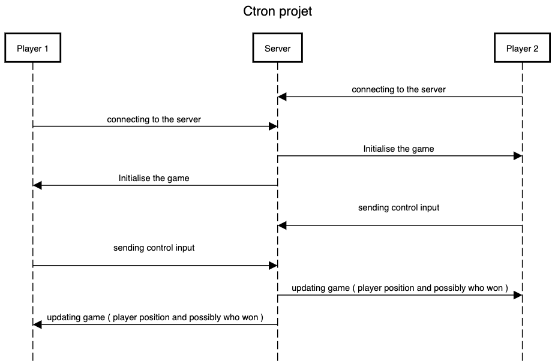

# C-Tron — Networked Light-Cycle Game in C

A two-player, terminal-based clone of the *Tron* light-cycle game, written in C with a client/server architecture over **TCP sockets**. The server runs the game simulation and is the single source of truth; clients only send inputs and render the board with **ncurses**.

Network Algorithms course project (*Algorithmes des Réseaux*), Licence Math-Info, Université de Strasbourg, 2022–2023. Report: [`Doc/ProjetRapport.pdf`](Doc/ProjetRapport.pdf).

<p align="center"></p>

## Architecture

- **Authoritative server** — accepts the players, advances the game at a configurable refresh rate, detects collisions, picks the winner and broadcasts the board state to all clients.
- **Thin clients** — read keyboard input, send it to the server, and draw each board update received.
- **Multiplexed I/O** — server and clients use `select()` to handle sockets and input without threads.
- **Two play modes** — one player per terminal (two clients), or two players sharing one terminal and one client.

| Module | Responsibility |
|---|---|
| `con.c` | Socket setup and connection handling (server and client) |
| `echange.c` | Send / receive helpers for game messages |
| `init.c` | Board initialisation, player positions, `fd_set` management |
| `compute.c` | Movement, light trails, collision detection, winner check (server side) |
| `gameplay.c` | Input handling and board rendering (client side) |
| `Server.c`, `Client.c` | Entry points |

The module dependency graph and function list are in [`Doc/`](Doc/).

## Build

Requires gcc or clang and ncurses.

```bash
make            # builds bin/Server and bin/Client
make clean_all  # removes debug symbols from bin/ and src/
```

## Run

```bash
./bin/Server <port> <refresh_rate>
./bin/Client <server_ip> <port> <players_on_this_terminal>   # 1 or 2
```

Example, two players on two terminals:

```bash
./bin/Server 5000 10
./bin/Client 127.0.0.1 5000 1     # terminal 1
./bin/Client 127.0.0.1 5000 1     # terminal 2
```

## Controls

| Action | Player 1 | Player 2 (shared terminal) |
|---|---|---|
| Up | `I` | `Z` |
| Down | `K` | `S` |
| Left | `J` | `Q` |
| Right | `L` | `D` |
| Hide light trail | `M` | `Space` |

## Author

**Ahmed Taleb Bechir**
[atbechir.com](https://atbechir.com) · [LinkedIn](https://www.linkedin.com/in/ahmed-taleb-bechir-97a7301a4) · [GitHub](https://github.com/talebbechir123)
